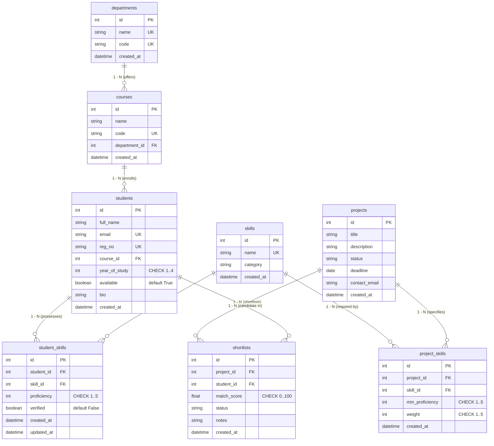

# SkillBridge – Smart Student Skill Finder & Project Matcher

SkillBridge is an intelligent university candidate matching and skill discovery platform built with **FastAPI**, **SQLAlchemy ORM**, **SQLite**, and **Pydantic v2**. It empowers academic institutions, research labs, and project coordinators to move beyond static resume files and manually shortlisting the same familiar students. SkillBridge answers the essential question: *"I have a project requiring X, Y, and Z skills. Who fits best, and why?"*

---

## Features

- **3NF Relational Database**: Complete academic hierarchy (`departments 1–N courses 1–N students`), normalized skill catalog, and many-to-many link tables.
- **Full RESTful CRUD Operations**: Robust endpoints for all 8 resources with proper HTTP status codes (`201 Created`, `204 No Content`, `404 Not Found`, `409 Conflict`, `422 Unprocessable Entity`).
- **Active Foreign Key Enforcement**: SQLite `PRAGMA foreign_keys=ON` automatically enabled on every connection. Deleting departments with courses or courses with students is blocked with `409 Conflict`.
- **Explainable Matching Engine**: Pure mathematical scoring function evaluating required skill levels with weights (1–5), capping over-qualification at 100%, and granting verification bonuses up to +5%.
- **Zero-Downtime Natural Language Search**: Optional AI parser with local **Ollama** converting plain-English queries into JSON filters. Automatically falls back to regex keyword parsing if Ollama is offline (no 500 errors).
- **Responsive Web Dashboard**: Clean vanilla HTML5, CSS3, and local **Chart.js** interface for browsing profiles, running live match algorithms, and managing candidate shortlists.

---

## Tech Stack

| Component | Technology | Rationale |
| :--- | :--- | :--- |
| **Language** | Python 3.11+ | Clean syntax, strong typing support, rich ecosystem |
| **Web Framework** | FastAPI | High performance, auto OpenAPI docs (`/docs`), Pydantic validation |
| **Database Engine**| SQLite (`skillbridge.db`) | Zero configuration, single-file storage, ideal for local university evaluations |
| **ORM** | SQLAlchemy 2.0 | Explicit Python object-relational mapping, connection listeners, cascades |
| **Validation** | Pydantic v2 | Strict request/response data contracts, regex validation, email checking |
| **Testing** | Pytest + HTTPX | Full test coverage for CRUD, foreign key constraints, and boundary conditions |
| **Frontend** | Vanilla JS + Chart.js | Zero build tools, offline vendor assets, safe DOM manipulation (`textContent`) |
| **Local AI (Opt)**| Ollama (`llama3.2`) | Local private LLM natural language filter parser; never writes raw SQL |

---

## Database Architecture (Entity-Relationship Diagram)



---

## Setup Steps (Windows)

### 1. Prerequisites
Ensure Python 3.11+ is installed. Open PowerShell and verify:
```powershell
py -3.11 --version
```

### 2. Install Project Dependencies
```powershell
py -3.11 -m pip install --upgrade pip
py -3.11 -m pip install -r requirements.txt
```

### 3. Environment Configuration
Copy the sample environment file:
```powershell
copy .env.example .env
```
Default `.env` settings:
```ini
DATABASE_URL=sqlite:///./skillbridge.db
OLLAMA_URL=http://localhost:11434
OLLAMA_MODEL=llama3.2
```

### 4. Seed Realistic Sample Data
The seeder is idempotent and safe to run multiple times without duplicating entries:
```powershell
py -3.11 seed.py
```
This populates 4 departments, 5 degree programs, 22 technical skills, 38 realistic student profiles with varied competencies, and 4 sample project listings.

### 5. Run the Application Server
```powershell
py -3.11 -m uvicorn app.main:app --reload
```
Once running, open your browser:
- **Web Dashboard**: [http://127.0.0.1:8000/app/index.html](http://127.0.0.1:8000/app/index.html)
- **Student Directory & AI Search**: [http://127.0.0.1:8000/app/students.html](http://127.0.0.1:8000/app/students.html)
- **Projects & Matcher**: [http://127.0.0.1:8000/app/projects.html](http://127.0.0.1:8000/app/projects.html)
- **Interactive Swagger API Docs**: [http://127.0.0.1:8000/docs](http://127.0.0.1:8000/docs)

---

## Running the Automated Test Suite

Run pytest to execute all 24 comprehensive unit and integration tests:
```powershell
py -3.11 -m pytest -v
```
All tests run against isolated in-memory/test SQLite databases with complete verification of:
- Full CRUD operations across all 8 tables
- Constraint validation (`year_of_study 1-4`, `proficiency 1-5`, `match_score 0-100`)
- Duplicate unique constraints and cascade deletion behaviors
- 409 Conflict handling on restricted parent deletes
- Pure matching formula calculations and boundary conditions
- Mocked Ollama AI search parsing and zero-downtime keyword fallback

---

## Enabling Local AI Search with Ollama (Optional)

The application functions completely without AI. However, if you wish to enable the local Ollama natural language query parser:

1. Download and install Ollama from [ollama.com](https://ollama.com).
2. Pull the default lightweight model in your terminal:
   ```powershell
   ollama pull llama3.2
   ```
3. Start the Ollama daemon (it runs on port 11434 by default):
   ```powershell
   ollama serve
   ```
4. Verify connectivity via SkillBridge:
   - Navigate to [http://127.0.0.1:8000/api/v1/ai/status](http://127.0.0.1:8000/api/v1/ai/status) or use the Smart Search box on `students.html`.

---

## Match Score Formula & Worked Example

$$\text{Base Score} = \frac{\sum \left( \text{weight} \times \min\left( \frac{\text{student\_level}}{\text{min\_proficiency}}, 1.0 \right) \right)}{\sum \text{weight}} \times 100$$

$$\text{Verified Bonus} = 5.0 \times \left( \frac{\text{verified\_matched\_skills}}{\text{total\_matched\_skills}} \right)$$

$$\text{Final Score} = \min(100.0, \text{round}(\text{Base Score} + \text{Verified Bonus}, 1))$$

### Worked Calculation Example
**Project Requirements**:
1. **Python**: Required Level = 4, Weight = 3
2. **FastAPI**: Required Level = 2, Weight = 2
3. **Docker**: Required Level = 3, Weight = 1
- **Total Weight** = $3 + 2 + 1 = 6$

**Student Profile**:
- **Python**: Level = 2 (Unverified) $\rightarrow \text{Ratio} = \min(2/4, 1.0) = 0.5 \rightarrow \text{Contribution} = 3 \times 0.5 = 1.5$
- **FastAPI**: Level = 4 (Verified) $\rightarrow \text{Ratio} = \min(4/2, 1.0) = 1.0 \rightarrow \text{Contribution} = 2 \times 1.0 = 2.0$ *(Over-qualification capped)*
- **Docker**: Missing $\rightarrow \text{Contribution} = 1 \times 0.0 = 0.0$

**Calculations**:
- **Weighted Sum** = $1.5 + 2.0 + 0.0 = 3.5$
- **Base Score** = $(3.5 / 6) \times 100 = 58.33\%$
- **Verified Bonus** = Student has 2 matched skills (Python, FastAPI); 1 is verified $\rightarrow 5.0 \times (1 / 2) = +2.5\%$
- **Final Match Score** = $\text{round}(58.33 + 2.5, 1) = \mathbf{60.8\%}$

---

## Full API Endpoints Table

| Category | Method | Path | Status | Description |
| :--- | :--- | :--- | :--- | :--- |
| **System** | `GET` | `/` | 200 | Application health check and metadata |
| **Departments** | `POST` | `/api/v1/departments/` | 201 | Create academic department |
| | `GET` | `/api/v1/departments/` | 200 | List departments with pagination |
| | `GET` | `/api/v1/departments/{id}` | 200 | Get department details |
| | `PUT` | `/api/v1/departments/{id}` | 200 | Update department |
| | `DELETE` | `/api/v1/departments/{id}` | 204 | Delete department (blocked with 409 if courses exist) |
| **Courses** | `POST` | `/api/v1/courses/` | 201 | Create degree program |
| | `GET` | `/api/v1/courses/` | 200 | List courses (filter by `department_id`) |
| | `GET` | `/api/v1/courses/{id}` | 200 | Get course details |
| | `PUT` | `/api/v1/courses/{id}` | 200 | Update course details |
| | `DELETE` | `/api/v1/courses/{id}` | 204 | Delete course (blocked with 409 if students exist) |
| **Students** | `POST` | `/api/v1/students/` | 201 | Register student profile |
| | `GET` | `/api/v1/students/` | 200 | List students (filter by course, year, availability) |
| | `GET` | `/api/v1/students/search` | 200 | Multi-criteria search (skills AND/OR, course, dept, year) |
| | `GET` | `/api/v1/students/{id}` | 200 | Get student profile details |
| | `PUT` | `/api/v1/students/{id}` | 200 | Update student profile |
| | `DELETE` | `/api/v1/students/{id}` | 204 | Delete student (cascades to skills and shortlists) |
| **Skills** | `POST` | `/api/v1/skills/` | 201 | Create skill in catalog |
| | `GET` | `/api/v1/skills/` | 200 | List skills (filter by category, search by name) |
| | `GET` | `/api/v1/skills/{id}` | 200 | Get skill details |
| | `PUT` | `/api/v1/skills/{id}` | 200 | Update skill details |
| | `DELETE` | `/api/v1/skills/{id}` | 204 | Delete skill (blocked with 409 if in active use) |
| **Student Skills**| `POST` | `/api/v1/student-skills/` | 201 | Map skill to student with proficiency (1-5) and verification |
| | `GET` | `/api/v1/student-skills/` | 200 | List student-skill links |
| | `GET` | `/api/v1/student-skills/{id}` | 200 | Get single link record |
| | `PUT` | `/api/v1/student-skills/{id}` | 200 | Update proficiency level or verification status |
| | `DELETE` | `/api/v1/student-skills/{id}` | 204 | Remove skill from student |
| **Projects** | `POST` | `/api/v1/projects/` | 201 | Create new project initiative |
| | `GET` | `/api/v1/projects/` | 200 | List projects (filter by `status`) |
| | `GET` | `/api/v1/projects/{id}` | 200 | Get project details |
| | `PUT` | `/api/v1/projects/{id}` | 200 | Update project details |
| | `DELETE` | `/api/v1/projects/{id}` | 204 | Delete project (cascades to requirements and shortlists) |
| **Project Skills**| `POST` | `/api/v1/project-skills/` | 201 | Add required skill with min proficiency (1-5) and weight (1-5) |
| | `GET` | `/api/v1/project-skills/` | 200 | List project skill requirements |
| | `GET` | `/api/v1/project-skills/{id}` | 200 | Get requirement details |
| | `PUT` | `/api/v1/project-skills/{id}` | 200 | Update requirement min level or weight |
| | `DELETE` | `/api/v1/project-skills/{id}` | 204 | Remove requirement from project |
| **Shortlists** | `POST` | `/api/v1/shortlists/` | 201 | Shortlist student candidate for project |
| | `GET` | `/api/v1/shortlists/` | 200 | List shortlists (filter by project, student, status) |
| | `GET` | `/api/v1/shortlists/{id}` | 200 | Get shortlist entry |
| | `PUT` | `/api/v1/shortlists/{id}` | 200 | Update status (`shortlisted`, `contacted`, `selected`) |
| | `DELETE` | `/api/v1/shortlists/{id}` | 204 | Remove candidate from shortlist |
| **Matching Engine**| `GET` | `/api/v1/matching/projects/{id}/students` | 200 | Rank student candidates for project descending by score |
| | `GET` | `/api/v1/matching/students/{id}/projects` | 200 | Rank open projects for student descending by score |
| | `POST` | `/api/v1/matching/projects/{id}/auto-shortlist` | 200 | Auto-shortlist top N candidates (skipping existing) |
| **Dashboard** | `GET` | `/api/v1/dashboard/stats` | 200 | Aggregated metrics, top skills, department distributions |
| **AI Search** | `GET` | `/api/v1/ai/status` | 200 | Check if local Ollama daemon is reachable |
| | `POST` | `/api/v1/ai/search` | 200 | Natural language query search with fallback |

---

## Screenshots Placeholder

*Place evaluation demo screenshots below:*

1. **Executive Dashboard**: ``
2. **Student Directory & Multi-Criteria Search**: ``
3. **Smart Natural Language Search with Interpreted Badges**: ``
4. **Project Matcher with Ranked Candidate Score Breakdown**: ``

---

## Limitations

1. **Self-Claimed Proficiency**: Unless explicitly marked as `Verified` by faculty, skill ratings are self-reported by students.
2. **Local Single-File Database**: SQLite is designed for single-node development and quick university evaluations. Production concurrent write scale requires PostgreSQL.
3. **Keyword Parsing Boundary**: While Ollama parses nuanced phrasing, the offline keyword parser relies on token boundary matching for known skill catalog terms.

---

## Future Work

- **Role-Based Access Control (RBAC)**: JWT-based authentication separating Faculty/Admins from Student self-service profiles.
- **Automated Resume Skill Extractor**: PDF/DOCX resume upload with automatic extraction and mapping to catalog skills.
- **Institutional Skill Gap Heatmap**: Curriculum analytics identifying technologies demanded by projects that students currently lack.
- **CSV Data Import/Export**: Batch bulk upload for registrar rosters and candidate export for university placement cells.
